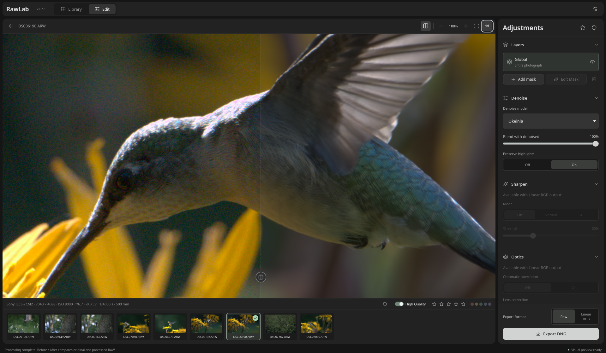

# RawLab

RawLab is a vibe-coded RAW photo preprocessor with AI denoising, local masks, and DNG export.



## Features

- Global and local denoise layers
- SAM 2.1 masks with point prompts and manual brush editing
- Bayer CFA and Linear RGB DNG export
- Sharpening: Normal and DeepSharpen
- Lensfun chromatic-aberration and lens corrections
- Batch processing with recovery
- Darktable integration with Lua script
- CPU and supported GPU inference through ONNX Runtime

## Build From Source

See [Linux installation](docs/linux-install.md) for AppImage usage, distribution
dependencies, and native build and installation instructions.

Install C++20, CMake 3.25+, Ninja, Qt 6 Core/Gui/Network, LibRaw, libtiff,
libpng, Lensfun, and the ONNX Runtime C API. The ONNX Runtime installation must
provide `onnxruntime_c_api.h` and its shared library.

Install Node.js 20.19+, npm, Rust/Cargo, and WebKitGTK 4.1 development files for
the desktop editor.

Build and test the native code:

```bash
cmake --preset dev
cmake --build --preset dev --parallel 2
ctest --preset dev
```

Build and run the desktop editor:

```bash
cd desktop
npm ci
RAWLAB_ALLOW_DEBUG_ENGINE=1 npm run desktop:prepare
npm run build
npm test
cargo test --manifest-path src-tauri/Cargo.toml
npm run desktop
```

## Downloads

Download the Linux x64 AppImage, Windows x64 installer, or macOS Apple Silicon
DMG from [Releases](https://github.com/AyedaOk/rawlab/releases).
The macOS app uses ad-hoc signing; macOS may require **Open Anyway** in
System Settings > Privacy & Security. Lensfun corrections are unavailable in
the current Windows package.

Release packages include CPU ONNX Runtime. GPU acceleration requires a compatible
external ONNX Runtime and its platform dependencies; choose its library in Preferences.

## Models and Data

RawLab does not include model weights. Use **Preferences** to download or add
local models. Model licenses remain separate from the RawLab license.

## Darktable

Install `packaging/darktable/RawLab.lua` in Darktable's Lua configuration.

## Acknowledgments

RawLab acknowledges these projects and publications:

- [RawForge](https://github.com/rymuelle/RawForge), by rymuelle.
- [Raw Natural Image Noise Dataset](https://doi.org/10.14428/DVN/DEQCIM), by Benoit Brummer and Christophe De Vleeschouwer.
- [NAFNet](https://doi.org/10.48550/arXiv.2208.04677), by Liangyu Chen and contributors.
- [darktable](https://darktable.org/), whose raw-processing work informs parts of the pipeline.
- [RapidRAW](https://github.com/CyberTimon/RapidRAW), used as a visual and workflow reference.
- [Lensfun](https://lensfun.github.io/), used for lens and chromatic-aberration correction data and processing.

## License

RawLab is licensed under GPLv3-or-later. Model files have their own licensing
terms (see `docs/model-licensing.md`).
